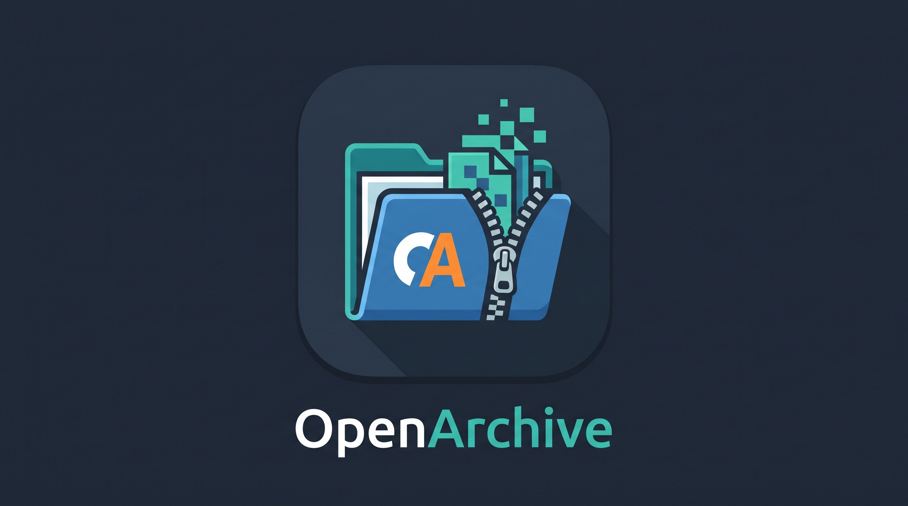
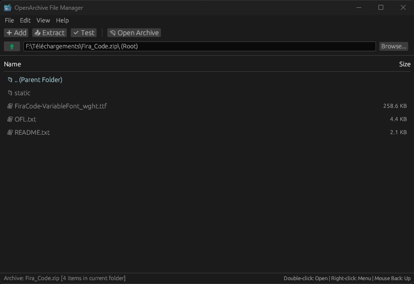
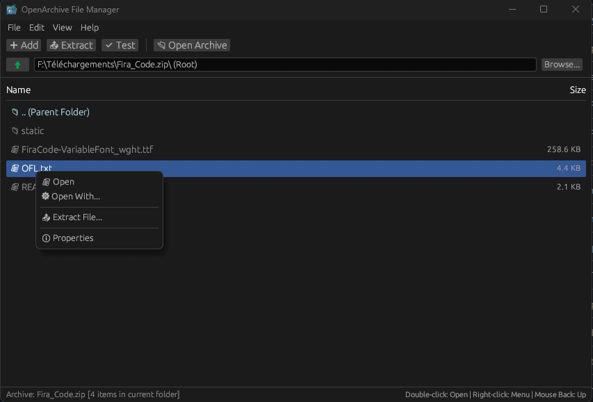
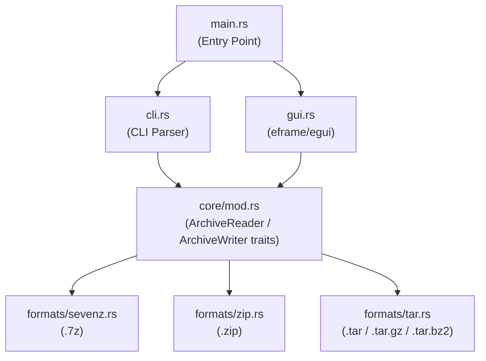

<p align="center">
  
</p>

<h1 align="center">OpenArchive</h1>

<p align="center">
  
  
  
  
</p>

<p align="center">
  A modern, pure-Rust archive manager with a file-manager-style GUI and a 7-Zip–compatible CLI.<br/>
  No C/C++ dependencies. Handles <code>.7z</code>, <code>.zip</code>, <code>.tar</code>, <code>.tar.gz</code>, and <code>.tar.bz2</code>.
</p>

---

## ✨ Features

| Category | Highlights |
|---|---|
| 🖥️ **GUI** | File-manager interface, navigate disk & archives, double-click to open, rubber-band multi-select |
| ⌨️ **CLI** | 7-Zip–compatible commands (`a`, `x`, `e`, `l`, `t`), familiar switches (`-o`, `-p`, `-mx`) |
| 📦 **Formats** | `.7z` · `.zip` · `.tar` · `.tar.gz` · `.tar.bz2` |
| 🦀 **Pure Rust** | Zero C/C++ runtime dependencies; single statically-linked binary |
| 🪟 **Windows** | Native MSI installer, taskbar icon, silent GUI launcher (no console window) |

---

## 📸 Screenshots

| File Manager | Right-click Menu |
|:---:|:---:|
|  |  |

---

## 🚀 Installation

### Download the MSI installer

The easiest way to get started is to download the pre-built Windows installer from the [GitHub Releases](https://github.com/LaurentBerder/OpenArchive/releases) page.

1. Go to **Releases** and download the latest `OpenArchive-x.x.x-x86_64.msi`.
2. Run the installer and follow the prompts.
3. Both the GUI (`openarchive-gui.exe`) and the CLI (`openarchive.exe`) are installed and added to your `PATH`.

### Build from source

**Prerequisites:** [Rust toolchain](https://rustup.rs/) (1.99+), Windows x86_64.

```powershell
# Clone the repository
git clone https://github.com/LaurentBerder/OpenArchive.git
cd OpenArchive

# Build release binaries
cargo build --release
```

The compiled binaries are placed in `target/release/`:
- `openarchive.exe` — CLI binary
- `openarchive-gui.exe` — Windowless GUI launcher

#### Build the MSI installer (optional)

Requires [WiX Toolset v3](https://wixtoolset.org/) installed and on your `PATH`.

```powershell
.\build-msi.ps1
```

---

## 🖥️ GUI Usage

Launch the GUI by running `openarchive-gui.exe` (or `openarchive.exe --gui`).

### Navigation

| Action | Result |
|---|---|
| **Double-click** file/folder | Open file or enter folder |
| **Double-click** archive | Browse archive contents |
| **Backspace** / **Alt+Up** | Go up one level / navigate back |
| **Mouse Back button** | Navigate up / back |
| **Mouse Forward button** | Navigate forward |
| **Enter** | Open selected item |
| **Escape** | Deselect all |

### Selection

| Action | Result |
|---|---|
| **Click** | Select single item |
| **Ctrl+Click** | Toggle item in/out of selection |
| **Shift+Click** | Select a contiguous range |
| **Ctrl+A** | Select all items |
| **Rubber-band drag** | Draw a selection rectangle |
| **Shift+Arrow keys** | Extend selection up/down |

### Context Menu (Right-Click)

- **Open** — open the item with its default application
- **Open With** — choose an application to open with
- **Extract** — extract the selected items (or the entire archive)
- **Properties** — view file/archive metadata

### Other Features

- **Extract whole archive** — select the archive root and choose Extract
- **Extract selected items** — select specific entries then Extract
- **Notification toasts** — brief on-screen feedback for operations
- **Properties window** — displays size, path, compression ratio, and more

---

## ⌨️ CLI Usage

```
openarchive <command> <archive> [files...] [switches]
```

### Commands

| Command | Description |
|---|---|
| `a` | **Add** files to an archive (creates the archive if it does not exist) |
| `x` | **Extract** archive preserving full directory structure |
| `e` | **Extract** archive flat (all files into the same output directory) |
| `l` | **List** contents of an archive |
| `t` | **Test** archive integrity |

### Switches

| Switch | Description |
|---|---|
| `-o{dir}` | Set output directory (e.g. `-oC:\Output`) |
| `-p{password}` | Set encryption password (e.g. `-pMySecret`) |
| `-mx={0..9}` | Compression level: 0 = store, 5 = default, 9 = ultra (e.g. `-mx=9`) |
| `-r` | Recurse into subdirectories |
| `-y` | Assume yes to all prompts |

### Examples

```powershell
# Create a .7z archive from a folder
openarchive a backup.7z C:\MyProject -r

# Create a .zip with maximum compression
openarchive a photos.zip *.jpg -mx=9

# Extract an archive to a specific folder
openarchive x archive.7z -oC:\Extracted

# Extract flat (no directory structure)
openarchive e archive.tar.gz -oC:\Flat

# List the contents of an archive
openarchive l archive.zip

# Test archive integrity
openarchive t archive.7z

# Extract with a password
openarchive x secret.7z -pMySecret -oC:\Output
```

---

## 🏗️ Architecture

```
OpenArchive
├── src/
│   ├── main.rs                  # CLI entry point & dispatcher
│   ├── cli.rs                   # CLI argument parsing
│   ├── gui.rs                   # GUI (eframe / egui)
│   ├── lib.rs                   # Library re-exports
│   ├── core/
│   │   └── mod.rs               # Core traits: ArchiveReader, ArchiveWriter
│   └── formats/
│       ├── sevenz.rs            # .7z handler
│       ├── zip.rs               # .zip handler
│       └── tar.rs               # .tar / .tar.gz / .tar.bz2 handler
├── src/bin/
│   └── openarchive-gui.rs       # Silent GUI launcher (no console window)
├── tests/
│   └── cli_tests.rs             # Integration tests
├── assets/
│   ├── OpenArchive_icon.jpg     # Application logo
│   ├── OpenArchive_favicon.ico  # Window/taskbar icon (embedded at compile time)
│   └── screenshots/             # UI screenshots
└── build-msi.ps1                # MSI packaging script (WiX v3)
```



---

## 🤝 Contributing

Contributions are welcome! Here is how to get started:

1. **Fork** the repository on GitHub.
2. **Create a branch** for your feature or fix:
   ```powershell
   git checkout -b feature/my-new-format
   ```
3. **Write tests** in `tests/cli_tests.rs` for any new behaviour.
4. **Run the test suite** before submitting:
   ```powershell
   cargo test
   ```
5. **Open a Pull Request** describing what you changed and why.

Please follow standard Rust style (`cargo fmt`, `cargo clippy`) and keep commits focused.

---

## 📄 License

This project is licensed under the **MIT License**.  
See the [LICENSE](LICENSE) file for the full text.

---

<p align="center">
  Made with 🦀 by <a href="https://github.com/LaurentBerder">Laurent Berder</a>
</p>
